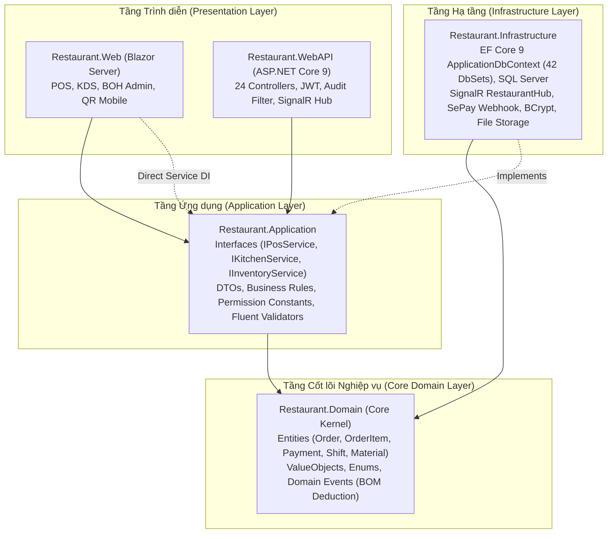
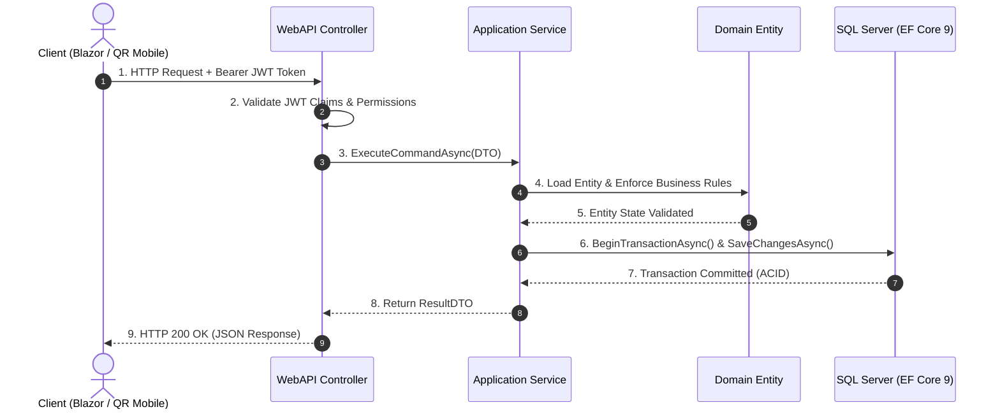
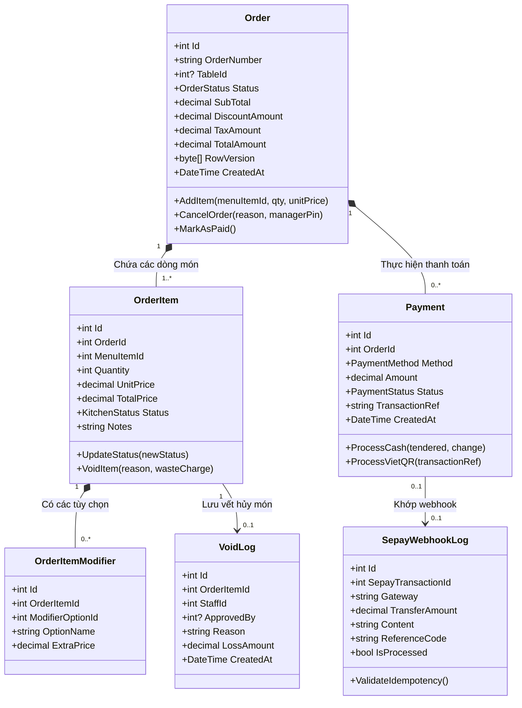
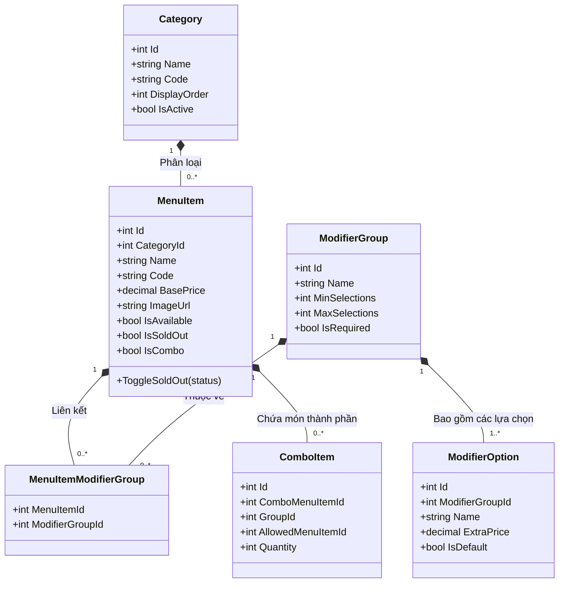
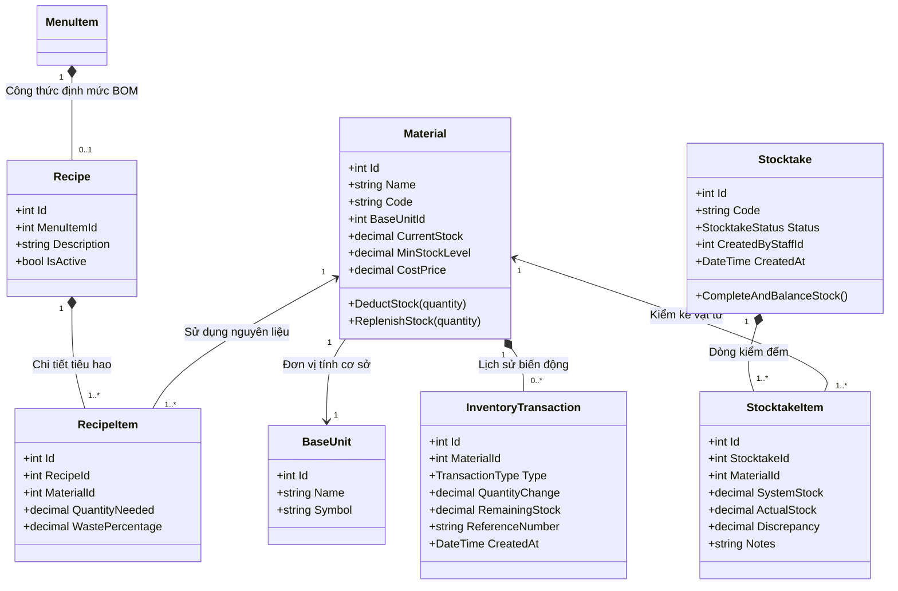
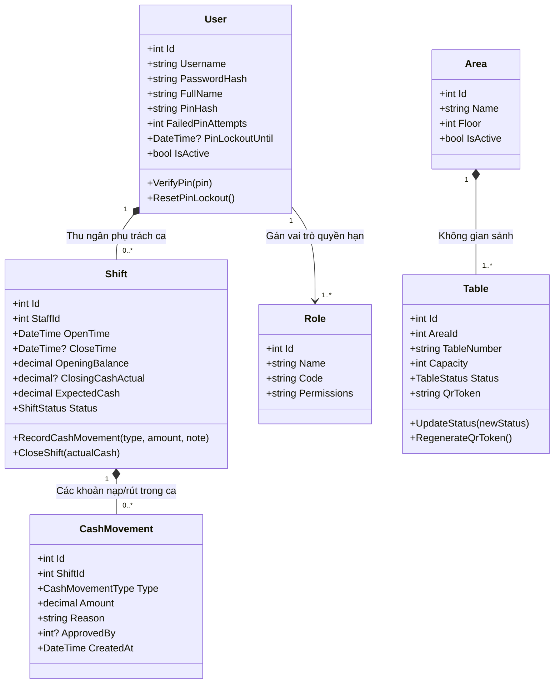

# PHÁC THẢO CẤU TRÚC BẢNG BIỂU VÀ SƠ ĐỒ CHƯƠNG 2
> Tài liệu kỹ thuật trung gian phục vụ rà soát, căn chỉnh độ rộng cột, lề ô và mã nguồn sơ đồ trước khi chuẩn hóa vào tệp Word báo cáo đồ án.
> Tuân thủ quy tắc xử lý bảng biểu và sơ đồ:
> - Tiêu đề in nghiêng đặt phía trên bảng.
> - Hàng tiêu đề có nền màu xanh nhạt (`#D9E2F3`), chữ đậm, bật `tblHeader` và `cantSplit`.
> - Bố cục bảng thoáng đãng, lề trong (cell padding) rộng rãi (top/bottom: 120 dxa, left/right: 180 dxa).
> - Sơ đồ được kiểm tra trực quan qua mã nguồn Mermaid chuẩn mực.

---

# PHẦN 1: PHÁC THẢO MÃ NGUỒN SƠ ĐỒ (DIAGRAMS DRAFT)

## 1. Hình 2.4: Sơ đồ kiến trúc Clean Architecture phân tầng phụ thuộc

---

## 2. Hình 2.5: Sơ đồ tuần tự xử lý yêu cầu hệ thống từ Client đến Database (9 Bước)

### Chi tiết 9 bước thực thi:
1. **Gửi yêu cầu HTTP kèm mã xác thực (Client Request):** Client (Blazor Server hoặc Mobile QR) gửi yêu cầu HTTP Request kèm Bearer JWT Token trong tiêu đề (Authorization Header) tới WebAPI Controllers.
2. **Xác thực JWT Claims và Phân quyền (Validate JWT Claims & Permissions):** Controller thông qua Authentication & Authorization Middleware tiến hành xác thực tính hợp lệ của token và đối chiếu vai trò người dùng (Role-based Policies) dựa trên các Claims đã cấp.
3. **Chuyển giao Command/Query DTO (ExecuteCommandAsync):** Sau khi vượt qua lớp bảo mật, Controller chuyển tiếp DTO dữ liệu và kích hoạt phương thức thực thi nghiệp vụ tương ứng (`ExecuteCommandAsync`) tại tầng Application Service.
4. **Nạp thực thể và Áp đặt quy tắc nghiệp vụ (Load Entity & Enforce Business Rules):** Application Service truy xuất thực thể Domain Entity tương ứng từ cơ sở dữ liệu, áp đặt các điều kiện bất biến (Domain Invariants) và kiểm tra tính hợp lệ của trạng thái logic (ví dụ: bàn ăn có đang mở ca, món ăn có khả dụng, hạn mức chiết khấu).
5. **Xác nhận trạng thái thực thể hợp lệ (Entity State Validated):** Thực thể Domain xử lý logic nội tại, biến đổi trạng thái thành công và phát sinh các Domain Events (nếu có), phản hồi lại tầng Application xác nhận trạng thái hợp lệ.
6. **Mở Transaction và Lưu thay đổi (BeginTransactionAsync & SaveChangesAsync):** Application Service gọi `ApplicationDbContext` của tầng Infrastructure để mở giao dịch cơ sở dữ liệu (`BeginTransactionAsync`) và đưa các đối tượng vào bộ theo dõi EF Core Change Tracker để chuẩn bị lưu trữ (`SaveChangesAsync`).
7. **Cam kết giao dịch cơ sở dữ liệu thành công (Transaction Committed ACID):** Tầng Infrastructure thực thi các câu lệnh SQL tối ưu xuống Microsoft SQL Server Database, cam kết giao dịch ở cấp độ cô lập Read Committed, bảo đảm trọn vẹn 4 thuộc tính ACID và cập nhật `RowVersion`.
8. **Đóng gói kết quả trả về (Return ResultDTO):** Application Service nhận kết quả xử lý từ tầng Infrastructure, ánh xạ thực thể Domain Entity sang Response DTO (ResultDTO) và bàn giao kết quả về tầng WebAPI Controller.
9. **Trả phản hồi HTTP tiêu chuẩn về Client (HTTP 200 OK Response):** Controller đóng gói kết quả trong cấu trúc phản hồi chuẩn hóa (Standard Response JSON) kèm mã trạng thái HTTP thích hợp (HTTP 200 OK, 400 Bad Request, 403 Forbidden) và gửi về cho Client giao diện.

---

## 3. Biểu đồ lớp phân hệ Đơn hàng, Dòng món và Giao dịch Thanh toán (Hình 2.3a)

---

## 4. Biểu đồ lớp phân hệ Danh mục, Món ăn và Nhóm Tùy chọn Modifier (Hình 2.3b)

---

## 5. Biểu đồ lớp phân hệ Nguyên vật liệu, Công thức Định lượng BOM và Giao dịch Kho (Hình 2.3c)

---

## 6. Biểu đồ lớp phân hệ Ca làm việc, Dòng tiền két và Báo cáo Z-Report (Hình 2.3d)

---

# PHẦN 2: PHÁC THẢO CẤU TRÚC 18 BẢNG BIỂU (TABLES DRAFT)

### Bảng 2.1: Đặc tả Use Case UC-01: Đặt món tại bàn qua mã QR (QR Ordering)
*Cấu trúc: 2 cột (Cột 1: 25% ~ 2100 dxa, Cột 2: 75% ~ 6324 dxa). Header nền `#D9E2F3`, lặp lại tiêu đề, cantSplit.*

| Thuộc tính Đặc tả | Nội dung Chi tiết |
| :--- | :--- |
| **Mã Ca sử dụng** | UC-01 |
| **Tên Ca sử dụng** | Đặt món tại bàn qua mã QR (QR Ordering) |
| **Tác nhân chính** | Khách hàng (Customer) |
| **Mô tả vắn tắt** | Cho phép khách hàng tự quét mã QR tại bàn, xem thực đơn số, tùy chỉnh món ăn và gửi yêu cầu đặt món tức thời tới hệ thống. |
| **Tiền điều kiện** | Bàn ăn đã được định danh mã QR hợp lệ trong hệ thống BOH Admin; thiết bị khách hàng có kết nối mạng Internet. |
| **Hậu điều kiện** | Đơn hàng trạng thái `Draft` được tạo thành công trên hệ thống; thông báo đặt món mới phát tới quầy POS của Thu ngân. |
| **Luồng sự kiện chính** | 1. Khách hàng dùng camera điện thoại quét mã QR dán tại bàn. 2. Hệ thống xác thực `QrToken`, mở phiên gọi món và tải thực đơn số kèm trạng thái món ăn. 3. Khách hàng duyệt danh mục, chọn món ăn, cấu hình tùy chọn modifier (mức đá, mức đường, topping chọn thêm) và ghi chú. 4. Khách hàng kiểm tra lại giỏ hàng và nhấn nút 'Gửi đơn gọi món'. 5. Hệ thống xác thực tính hợp lệ của bàn ăn, khởi tạo bản ghi đơn hàng ở trạng thái `Draft` và phát tín hiệu Realtime SignalR tới POS. |
| **Luồng rẽ nhánh** | 2a. Mã QR hết hạn hoặc bàn bị vô hiệu hóa: Hệ thống hiển thị cảnh báo lỗi và hướng dẫn khách liên hệ nhân viên phục vụ. 3a. Món ăn bị đầu bếp bấm Báo hết hàng (`IsSoldOut = true`): Hệ thống khóa nút chọn món và hiển thị nhãn 'Tạm ngưng phục vụ'. |
| **Quy tắc Nghiệp vụ** | BR-01: Khách hàng chỉ được gửi đơn khi bàn đang ở trạng thái khả dụng hoặc đang phục vụ chính bàn đó. BR-02: Phải chọn đủ số lượng modifier bắt buộc (`MinSelections` <= số lượng <= `MaxSelections`). |

---

### Bảng 2.2: Đặc tả Use Case UC-02: Tiếp nhận và duyệt đơn hàng tại quầy POS
*Cấu trúc: 2 cột (Cột 1: 25% ~ 2100 dxa, Cột 2: 75% ~ 6324 dxa).*

| Thuộc tính Đặc tả | Nội dung Chi tiết |
| :--- | :--- |
| **Mã Ca sử dụng** | UC-02 |
| **Tên Ca sử dụng** | Tiếp nhận và duyệt đơn hàng tại quầy POS |
| **Tác nhân chính** | Nhân viên Thu ngân (Cashier) |
| **Mô tả vắn tắt** | Thu ngân kiểm tra danh sách món do khách đặt qua QR, đối chiếu thực tế và bấm nút duyệt để phân bổ vé chế biến xuống nhà bếp KDS. |
| **Tiền điều kiện** | Thu ngân đã đăng nhập thành công vào phiên làm việc POS; có ít nhất một đơn hàng trạng thái `Draft` được gửi từ khách. |
| **Hậu điều kiện** | Trạng thái đơn hàng chuyển sang `Confirmed`; bàn ăn chuyển sang màu Đỏ (`Occupied`); các vé chế biến hiển thị trên màn hình KDS. |
| **Luồng sự kiện chính** | 1. Màn hình POS nhận thông báo âm thanh và hiệu ứng nhấp nháy màu Vàng (`NewOrder`) tại vị trí bàn khách vừa gọi. 2. Thu ngân bấm vào bàn để mở chi tiết đơn hàng Draft. 3. Thu ngân đối chiếu số lượng món, các modifier đi kèm và ghi chú đặc biệt. 4. Thu ngân bấm nút 'Duyệt đơn hàng'. 5. Hệ thống cập nhật trạng thái đơn thành `Confirmed`, kích hoạt phát sự kiện Realtime `KitchenTicketReceived` tới KDS và cập nhật giao diện khách hàng. |
| **Luồng rẽ nhánh** | 3a. Khách gọi nhầm bàn hoặc yêu cầu hủy trước khi duyệt: Thu ngân chọn 'Hủy đơn', chọn lý do hủy; hệ thống cập nhật đơn thành `Cancelled` và giải phóng bàn. 3b. Nhà bếp báo hết nguyên liệu đột xuất: Thu ngân điều chỉnh bỏ món đó trước khi duyệt và thông báo cho khách. |
| **Quy tắc Nghiệp vụ** | BR-03: Thao tác duyệt đơn lập tức ràng buộc khách hàng vào bàn ăn, không cho phép quét QR mở phiên gọi món của bàn khác khi đơn chưa hoàn tất. |

---

### Bảng 2.3: Đặc tả Use Case UC-03: Điều phối và chế biến món ăn tại KDS
*Cấu trúc: 2 cột (Cột 1: 25% ~ 2100 dxa, Cột 2: 75% ~ 6324 dxa).*

| Thuộc tính Đặc tả | Nội dung Chi tiết |
| :--- | :--- |
| **Mã Ca sử dụng** | UC-03 |
| **Tên Ca sử dụng** | Điều phối và chế biến món ăn tại KDS |
| **Tác nhân chính** | Đầu bếp / Nhân viên Pha chế (Kitchen Chef) |
| **Mô tả vắn tắt** | Tiếp nhận vé làm món trên màn hình bếp KDS, quản lý thứ tự chế biến, cập nhật tiến độ và kích hoạt trừ tồn kho nguyên vật liệu tự động. |
| **Tiền điều kiện** | Đơn hàng đã được duyệt tại quầy POS (`Confirmed`); trạm bếp KDS được kết nối WebSocket tới `RestaurantHub`. |
| **Hậu điều kiện** | Món ăn chuyển trạng thái `Done`; nguyên vật liệu tương ứng bị trừ khỏi hệ thống kho; thông báo món sẵn sàng được phát tới nhân viên bàn. |
| **Luồng sự kiện chính** | 1. Thẻ món ăn hiển thị trong cột 'Chờ chế biến' (`Pending`) kèm đồng hồ đếm thời gian thực. 2. Đầu bếp bấm nút 'Nhận làm' khi bắt đầu thao tác; dòng món chuyển sang trạng thái `Processing` (màu Vàng). 3. Sau khi hoàn thành chế biến, đầu bếp bấm nút 'Hoàn thành' (`Done`). 4. Hệ thống tự động kích hoạt luồng trừ tồn kho nguyên liệu theo định lượng BOM (UC-06). 5. Hệ thống phát sự kiện `OrderItemStatusChanged` để cập nhật trạng thái trên màn hình POS và điện thoại khách hàng. |
| **Luồng rẽ nhánh** | 1a. Trạm bếp bị quá tải hoặc thiếu nguyên vật liệu: Đầu bếp kích hoạt tính năng Báo hết món (`ToggleSoldOut`), hệ thống lập tức khóa món trên toàn mạng lưới POS và QR. 2a. Đầu bếp sử dụng tính năng Gom món (Batch Aggregation) để nấu chung một mẻ các món giống nhau giữa nhiều bàn khác nhau. |
| **Quy tắc Nghiệp vụ** | BR-04: Món ăn vượt quá thời gian phục vụ định mức (SLA = 15 phút) sẽ tự động đổi sang màu đỏ cảnh báo nhấp nháy trên KDS. |

---

### Bảng 2.4: Đặc tả Use Case UC-04: Thanh toán hóa đơn và đối soát tự động VietQR
*Cấu trúc: 2 cột (Cột 1: 25% ~ 2100 dxa, Cột 2: 75% ~ 6324 dxa).*

| Thuộc tính Đặc tả | Nội dung Chi tiết |
| :--- | :--- |
| **Mã Ca sử dụng** | UC-04 |
| **Tên Ca sử dụng** | Thanh toán hóa đơn và đối soát tự động VietQR |
| **Tác nhân chính** | Nhân viên Thu ngân, Khách hàng, Hệ thống VietQR SePay |
| **Mô tả vắn tắt** | Thực hiện thanh toán tiền mặt hoặc chuyển khoản VietQR tự động khớp giao dịch qua Webhook SePay, in hóa đơn kết thúc bữa ăn. |
| **Tiền điều kiện** | Đơn hàng có toàn bộ món đã phục vụ (`Completed`); bàn ăn ở trạng thái chờ thanh toán (`Billing`). |
| **Hậu điều kiện** | Đơn hàng chuyển sang `Paid`; giao dịch thanh toán được ghi nhận; bàn ăn được giải phóng về trạng thái `Available`; điểm tích lũy được cộng cho khách. |
| **Luồng sự kiện chính** | 1. Thu ngân bấm chọn bàn, kiểm tra chi tiết hóa đơn, áp dụng voucher khuyến mãi hoặc mã giảm giá khách hàng thân thiết. 2. Thu ngân bấm 'In phiếu tạm tính' gửi khách hàng kiểm tra. 3. Khách hàng lựa chọn phương thức thanh toán VietQR. 4. Hệ thống sinh mã động VietQR tĩnh kèm số tiền chính xác và nội dung cú pháp chuẩn (`DH[Id]`). 5. Khách hàng quét mã bằng ứng dụng ngân hàng và hoàn tất chuyển khoản. 6. Cổng thanh toán SePay gửi tín hiệu Webhook xác nhận biến động số dư tới hệ thống. 7. Hệ thống tự động xác thực chữ ký số, khớp mã đơn hàng, ghi nhận thanh toán `Paid` và tự động in hóa đơn hoàn tất. |
| **Luồng rẽ nhánh** | 3a. Khách hàng chọn thanh toán Tiền mặt: Thu ngân nhập số tiền khách đưa, hệ thống tính tiền thừa cần trả, bấm 'Xác nhận thanh toán' để đóng đơn. 6a. Quá thời gian chờ (Timeout 180s) chưa nhận được Webhook: Thu ngân có thể bấm nút 'Kiểm tra giao dịch thủ công' hoặc chuyển phương thức thanh toán khác. |
| **Quy tắc Nghiệp vụ** | BR-05: Webhook SePay bắt buộc phải được xử lý bảo đảm tính Idempotency (chống trùng lặp giao dịch). BR-06: Bàn chỉ được giải phóng sau khi tổng số tiền thanh toán bằng đúng tổng giá trị hóa đơn. |

---

### Bảng 2.5: Đặc tả Use Case UC-05: Quản lý ca làm việc và chốt két thu ngân (Z-Report)
*Cấu trúc: 2 cột (Cột 1: 25% ~ 2100 dxa, Cột 2: 75% ~ 6324 dxa).*

| Thuộc tính Đặc tả | Nội dung Chi tiết |
| :--- | :--- |
| **Mã Ca sử dụng** | UC-05 |
| **Tên Ca sử dụng** | Quản lý ca làm việc và chốt két thu ngân (Z-Report) |
| **Tác nhân chính** | Nhân viên Thu ngân, Quản lý ca (Store Manager) |
| **Mô tả vắn tắt** | Quản lý vòng đời ca làm việc: mở ca đầu ngày, kiểm soát tiền két đầu ca, ghi nhận nạp/rút tiền giữa ca và kết ca đối soát in báo cáo Z-Report. |
| **Tiền điều kiện** | Thu ngân có tài khoản hợp lệ được phân quyền vận hành POS; trạm máy POS chưa có ca nào đang hoạt động. |
| **Hậu điều kiện** | Ca làm việc đóng (`Closed`); dữ liệu chênh lệch tiền két được ghi nhận; phiếu báo cáo kết ca K80 được in ra và lưu vết đối soát BOH. |
| **Luồng sự kiện chính** | 1. Đầu ca, thu ngân đăng nhập, chọn trạm máy POS và nhập số tiền mặt đầu ca (`OpeningBalance`). 2. Hệ thống mở ca (`Open`), cho phép bắt đầu ghi nhận các đơn hàng bán lẻ. 3. Trong ca, thu ngân ghi nhận các giao dịch nạp tiền lẻ (Till In) hoặc rút tiền nộp quỹ (Till Out) kèm lý do rõ ràng. 4. Cuối ca, thu ngân hoàn tất mọi đơn hàng còn dang dở và bấm nút 'Kết thúc ca làm việc'. 5. Thu ngân kiểm đếm tiền mặt thực tế trong két và nhập giá trị `ClosingCashActual`. 6. Hệ thống tính toán tổng doanh thu tiền mặt lý thuyết (`ExpectedCash`) và xác định chênh lệch (`Difference = ClosingCashActual - ExpectedCash`). 7. Thu ngân xác nhận đóng ca, hệ thống in phiếu kết ca Z-Report K80 và đồng bộ số liệu lên trung tâm báo cáo BOH Admin. |
| **Luồng rẽ nhánh** | 5a. Số tiền chênh lệch vượt quá hạn mức cho phép (ví dụ: > 100.000 VNĐ): Hệ thống yêu cầu bắt buộc nhập mã PIN Quản lý ca để phê duyệt lý do giải trình trước khi đóng ca. |
| **Quy tắc Nghiệp vụ** | BR-07: Không thể đóng ca khi còn bàn ăn đang phục vụ (`Occupied` hoặc `Billing`). BR-08: Mọi giao dịch tài chính sau khi đóng ca bắt buộc phải thuộc về một phiên ca mới. |

---

### Bảng 2.6: Đặc tả Use Case UC-06: Cấu hình định mức BOM và trừ tồn tự động
*Cấu trúc: 2 cột (Cột 1: 25% ~ 2100 dxa, Cột 2: 75% ~ 6324 dxa).*

| Thuộc tính Đặc tả | Nội dung Chi tiết |
| :--- | :--- |
| **Mã Ca sử dụng** | UC-06 |
| **Tên Ca sử dụng** | Cấu hình định mức BOM và trừ tồn tự động |
| **Tác nhân chính** | Quản lý nhà hàng (Store Manager), Tự động hóa hệ thống (System Background) |
| **Mô tả vắn tắt** | Thiết lập bảng định mức nguyên vật liệu tiêu hao (BOM) cho từng món ăn/modifier và tự động trừ tồn kho tức thời khi bếp bấm hoàn thành món. |
| **Tiền điều kiện** | Danh mục nguyên vật liệu đã được thiết lập đầy đủ đơn vị tính và định giá nhập kho; món ăn đã tồn tại trên thực đơn. |
| **Hậu điều kiện** | Bản ghi công thức BOM được lưu trữ; mỗi lượt chế biến món thành công sẽ tự động sinh bản ghi xuất kho và cập nhật số dư tồn. |
| **Luồng sự kiện chính** | 1. Quản lý truy cập phân hệ BOH Admin, chọn món ăn và thiết lập công thức tiêu hao (`Recipe`). 2. Thêm từng dòng nguyên vật liệu cần dùng, xác định khối lượng tiêu chuẩn (`QuantityNeeded`) và tỷ lệ hao hụt kỹ thuật (`WastePercentage`). 3. Quản lý lưu công thức, hệ thống kích hoạt trạng thái hiệu lực của BOM. 4. Khi nhà bếp KDS hoàn tất chế biến món ăn (`OrderItem.Status = Done`), Domain Event kích hoạt dịch vụ `InventoryService`. 5. Hệ thống truy vấn công thức BOM của món ăn, tính toán tổng khối lượng tiêu hao (bao gồm cả các modifier có BOM đi kèm). 6. Hệ thống thực thi trừ số lượng tồn kho `CurrentStock` của từng nguyên vật liệu và sinh bản ghi giao dịch kho `InventoryTransaction` loại `BOMDeduction`. |
| **Luồng rẽ nhánh** | 6a. Số lượng tồn kho của một nguyên vật liệu giảm xuống dưới ngưỡng cảnh báo `MinStockLevel`: Hệ thống tự động gửi thông báo cảnh báo bổ sung hàng tới Quản lý và đổi màu cảnh báo trên bảng điều khiển kho. |
| **Quy tắc Nghiệp vụ** | BR-09: Thao tác trừ kho BOM bắt buộc phải nằm trong cùng một Database Transaction với thao tác cập nhật trạng thái món để đảm bảo nguyên lý toàn vẹn dữ liệu ACID. |

---

### Bảng 2.7: Đặc tả kỹ thuật tính năng Bán hàng & Phục vụ Bàn (POS-001 đến POS-010)
*Cấu trúc: 6 cột (Mã FT: 11%, Tên: 20%, Actor: 12%, Ưu tiên: 11%, Mô tả Luồng: 31%, Bảng tương tác: 15%).*

| Mã FT | Tên Tính năng | Actor | Ưu tiên | Mô tả Luồng Nghiệp vụ | Bảng tương tác |
| :--- | :--- | :--- | :--- | :--- | :--- |
| POS-001 | Sơ đồ bàn trực quan | Thu ngân | Bắt buộc | Hiển thị sơ đồ bàn theo khu vực, trực quan hóa màu sắc trạng thái (Trống, Đang phục vụ, Đơn mới, Chờ thanh toán) | `Tables`, `Areas` |
| POS-002 | Tạo đơn tại bàn (Dine-in) | Thu ngân | Bắt buộc | Mở bàn ăn, tạo đơn hàng gắn với vị trí bàn, chuyển trạng thái bàn sang `Occupied` | `Orders`, `Tables` |
| POS-003 | Tạo đơn mang đi (Takeaway) | Thu ngân | Bắt buộc | Khởi tạo đơn bán mang đi không ràng buộc bàn ăn, gán tiền tố mã đơn đặc thù | `Orders` |
| POS-004 | Thêm món và tùy chọn | Thu ngân | Bắt buộc | Duyệt thực đơn nhanh, chọn món, chọn nhóm modifier (đường, đá, topping), kiểm tra tồn kho | `OrderItems`, `OrderItemModifiers` |
| POS-005 | Đặt món Combo linh hoạt | Thu ngân | Nâng cao | Chọn món combo gồm nhiều nhóm món con, áp dụng giá trọn gói và tùy biến món thành phần | `OrderItems`, `ComboItems` |
| POS-006 | Đổi điểm thưởng lấy món | Thu ngân | Nâng cao | Khấu trừ điểm thưởng tích lũy của khách hàng để nhận món quà tặng với đơn giá 0 VNĐ | `LoyaltyTransactions`, `OrderItems` |
| POS-007 | Hủy món phân quyền (Void Item) | Thu ngân, Quản lý | Bắt buộc | Hủy món ăn chưa nấu hoặc đã nấu; yêu cầu mã PIN Quản lý phê duyệt và lưu vết nhật ký thất thoát | `VoidLogs`, `OrderItems` |
| POS-008 | Hủy toàn bộ đơn hàng | Thu ngân, Quản lý | Bắt buộc | Hủy đơn hàng dang dở, giải phóng bàn ăn về trạng thái trống, bắt buộc ghi rõ nguyên nhân | `Orders`, `Tables` |
| POS-009 | Chuyển bàn / Gộp bàn | Thu ngân | Bắt buộc | Di chuyển toàn bộ món sang bàn mới hoặc sáp nhập hai đơn hàng của hai bàn ăn thành một | `Orders`, `Tables` |
| POS-010 | Tách hóa đơn thanh toán | Thu ngân | Bắt buộc | Tách một đơn hàng lớn thành nhiều đơn hàng con để khách thanh toán riêng lẻ từng phần | `Orders`, `OrderItems` |

---

### Bảng 2.8: Đặc tả kỹ thuật tính năng Thanh toán & Quản trị Ca (POS-011 đến POS-021)
*Cấu trúc: 6 cột (Mã FT: 11%, Tên: 20%, Actor: 12%, Ưu tiên: 11%, Mô tả Luồng: 31%, Bảng tương tác: 15%).*

| Mã FT | Tên Tính năng | Actor | Ưu tiên | Mô tả Luồng Nghiệp vụ | Bảng tương tác |
| :--- | :--- | :--- | :--- | :--- | :--- |
| POS-011 | Tra cứu khách hàng thân thiết | Thu ngân | Bắt buộc | Tìm kiếm theo số điện thoại, hiển thị hạng thẻ, tổng chi tiêu và số điểm tích lũy khả dụng | `Customers`, `CustomerTiers` |
| POS-012 | Tiêu điểm thưởng trừ tiền | Thu ngân | Bắt buộc | Quy đổi điểm tích lũy thành số tiền chiết khấu giảm giá trực tiếp trên hóa đơn | `Orders`, `LoyaltyTransactions` |
| POS-013 | Áp dụng mã giảm giá (Voucher) | Thu ngân | Bắt buộc | Nhập mã voucher, kiểm tra điều kiện áp dụng (hạn dùng, giá trị đơn tối thiểu), trừ tiền | `Vouchers`, `Orders` |
| POS-014 | Chiết khấu đơn hàng linh hoạt | Thu ngân, Quản lý | Bắt buộc | Giảm giá theo % hoặc tiền mặt cố định; vượt ngưỡng cho phép phải có mã PIN Quản lý | `Orders` |
| POS-015 | Xác thực mã PIN Quản lý | Quản lý | Bắt buộc | Hộp thoại nhập PIN 4-6 số, đối chiếu chuỗi băm BCrypt, khóa tạm thời khi nhập sai quá 5 lần | `Users` |
| POS-016 | In phiếu tạm tính K80 | Thu ngân | Bắt buộc | Xuất lệnh in phiếu tạm tính tới máy in nhiệt K80 để khách đối chiếu trước khi thanh toán | `Orders` |
| POS-017 | Thanh toán tiền mặt | Thu ngân | Bắt buộc | Nhập số tiền khách đưa, tính tiền thừa, cập nhật trạng thái đơn sang `Paid`, in hóa đơn | `Payments`, `Orders`, `Shifts` |
| POS-018 | Thanh toán tự động VietQR | Thu ngân, Khách hàng | Bắt buộc | Sinh mã QR động, lắng nghe Webhook SePay qua SignalR, tự động đóng đơn khi nhận tiền | `Payments`, `SepayWebhookLogs` |
| POS-019 | Tiếp nhận và duyệt đơn QR | Thu ngân | Bắt buộc | Hiển thị thông báo đơn gọi món từ khách qua mã QR, kiểm tra và bấm duyệt chuyển bếp | `Orders`, `OrderItems` |
| POS-020 | Quản lý mở ca và chốt ca | Thu ngân | Bắt buộc | Nhập tiền đầu ca, theo dõi doanh thu trong ca, đếm tiền kết ca và in báo cáo Z-Report | `Shifts` |
| POS-021 | Nạp rút két tiền lẻ (Till In/Out) | Thu ngân | Bắt buộc | Ghi nhận các khoản nạp thêm tiền lẻ hoặc rút tiền nộp quỹ giữa ca làm việc | `CashMovements`, `Shifts` |

---

### Bảng 2.9: Đặc tả kỹ thuật 7 tính năng phân hệ Màn hình Nhà bếp (KDS)
*Cấu trúc: 6 cột (Mã FT: 11%, Tên: 20%, Actor: 12%, Ưu tiên: 11%, Mô tả Luồng: 31%, Bảng tương tác: 15%).*

| Mã FT | Tên Tính năng | Actor | Ưu tiên | Mô tả Luồng Nghiệp vụ | Bảng tương tác |
| :--- | :--- | :--- | :--- | :--- | :--- |
| KDS-001 | Xem danh sách vé món theo thứ tự | Đầu bếp | Bắt buộc | Hiển thị thẻ đơn hàng theo nguyên tắc vào trước làm trước (FIFO) kèm thời gian chờ | `Orders`, `OrderItems` |
| KDS-002 | Lọc theo trạm chế biến (Station) | Đầu bếp | Bắt buộc | Phân chia hiển thị theo trạm chuyên trách: Trạm Bếp nóng, Bếp lạnh, Pha chế đồ uống | `Stations`, `MenuItems` |
| KDS-003 | Nhận chế biến món ăn | Đầu bếp | Bắt buộc | Bấm chuyển trạng thái từ `Pending` sang `Processing`, cập nhật thời gian thực tới POS | `OrderItems` |
| KDS-004 | Hoàn thành món và trừ kho BOM | Đầu bếp | Bắt buộc | Bấm hoàn tất món (`Done`), tự động kích hoạt trừ số lượng tồn kho nguyên liệu BOM | `OrderItems`, `Materials` |
| KDS-005 | Gom món tổng hợp (Aggregation) | Đầu bếp | Nâng cao | Tự động tổng hợp số lượng của cùng một món ăn trên nhiều đơn để chế biến cùng mẻ | `OrderItems` |
| KDS-006 | Báo hết món tức thời (Sold Out) | Đầu bếp | Bắt buộc | Khóa nhanh trạng thái kinh doanh của món khi hết nguyên liệu, đồng bộ lập tức lên POS/QR | `MenuItems` |
| KDS-007 | Cảnh báo vi phạm thời gian phục vụ | Đầu bếp | Bắt buộc | Đổi màu thẻ món sang Đỏ nhấp nháy khi thời gian chờ vượt ngưỡng phục vụ cam kết (SLA) | `OrderItems` |

---

### Bảng 2.10: Đặc tả tính năng Thực đơn, Định lượng BOM & Quản lý Kho (BOH-001 đến BOH-010)
*Cấu trúc: 6 cột (Mã FT: 11%, Tên: 20%, Actor: 12%, Ưu tiên: 11%, Mô tả Luồng: 31%, Bảng tương tác: 15%).*

| Mã FT | Tên Tính năng | Actor | Ưu tiên | Mô tả Luồng Nghiệp vụ | Bảng tương tác |
| :--- | :--- | :--- | :--- | :--- | :--- |
| BOH-001 | Quản lý danh mục & món ăn | Quản lý | Bắt buộc | Thêm, sửa, xóa danh mục thực đơn, món ăn, cập nhật giá bán, hình ảnh và gắn trạm bếp | `Categories`, `MenuItems` |
| BOH-002 | Quản lý nhóm tùy chọn Modifier | Quản lý | Bắt buộc | Thiết lập nhóm tùy chọn (đường, đá, topping), cấu hình ràng buộc Min/Max và giá phụ thu | `ModifierGroups`, `ModifierOptions` |
| BOH-003 | Cấu hình định lượng BOM món ăn | Quản lý | Bắt buộc | Xây dựng công thức định mức nguyên liệu thô cấu thành nên từng món ăn và modifier | `Recipes`, `RecipeItems` |
| BOH-004 | Quản lý đơn vị tính và tỷ lệ quy đổi | Quản lý | Bắt buộc | Khai báo đơn vị tính chuẩn (kg, g, l, ml) và hệ số quy đổi giữa đơn vị nhập và xuất | `BaseUnits`, `UnitConversions` |
| BOH-005 | Quản lý danh mục nguyên vật liệu | Quản lý | Bắt buộc | Theo dõi thông tin nguyên liệu thô, giá vốn bình quân gia quyền và ngưỡng tồn an toàn | `Materials` |
| BOH-006 | Quản lý hồ sơ Nhà cung cấp | Quản lý | Nâng cao | Lưu thông tin liên hệ nhà cung ứng, địa chỉ, lịch sử giao hàng và công nợ vật tư | `Suppliers` |
| BOH-007 | Lập phiếu nhập kho nguyên liệu | Quản lý | Bắt buộc | Tạo phiếu nhập kho vật tư, tính toán tăng tồn kho tức thời và cập nhật giá vốn nhập | `GoodsReceipts`, `ReceiptItems` |
| BOH-008 | Kiểm kê kho và cân bằng tồn | Quản lý | Bắt buộc | Đếm số lượng thực tế, đối chiếu số tồn trên phần mềm, tự động xuất phiếu cân bằng hao hụt | `Stocktakes`, `StocktakeItems` |
| BOH-009 | Báo cáo biến động kho nguyên liệu | Quản lý | Bắt buộc | Xuất sổ chi tiết xuất-nhập-tồn, phân tích tiêu hao định mức thực tế so với lý thuyết | `InventoryTransactions` |
| BOH-010 | Quản lý sơ đồ bàn và mã QR | Quản lý | Bắt buộc | Cấu hình phòng bàn theo sơ đồ tầng, khởi tạo và in mã QR định danh bảo mật cho từng bàn | `Areas`, `Tables` |

---

### Bảng 2.11: Đặc tả tính năng Phê duyệt, Đối soát & Báo cáo (BOH-011 đến BOH-018)
*Cấu trúc: 6 cột (Mã FT: 11%, Tên: 20%, Actor: 12%, Ưu tiên: 11%, Mô tả Luồng: 31%, Bảng tương tác: 15%).*

| Mã FT | Tên Tính năng | Actor | Ưu tiên | Mô tả Luồng Nghiệp vụ | Bảng tương tác |
| :--- | :--- | :--- | :--- | :--- | :--- |
| BOH-011 | Quản lý chương trình khuyến mãi | Quản lý | Bắt buộc | Cấu hình mã voucher, giảm giá theo %, giảm tiền cố định, số lượng phát hành và hạn dùng | `Vouchers` |
| BOH-012 | Quản lý hồ sơ Khách hàng CRM | Quản lý | Bắt buộc | Quản trị dữ liệu khách, lịch sử tích điểm, xếp hạng thành viên và tần suất quay lại | `Customers`, `CustomerTiers` |
| BOH-013 | Trung tâm phê duyệt (Approval) | Quản lý | Bắt buộc | Tiếp nhận và phê duyệt trực tuyến các yêu cầu hủy món có tính tiền hao hụt và chiết khấu cao | `VoidLogs`, `Orders` |
| BOH-014 | Báo cáo doanh thu bán hàng | Quản lý | Bắt buộc | Thống kê doanh thu theo ngày, tuần, tháng, phân tích doanh số theo món và nhóm danh mục | `Orders`, `Payments` |
| BOH-015 | Đối soát ca làm việc thu ngân | Quản lý | Bắt buộc | Kiểm tra chi tiết lịch sử đóng mở ca, chênh lệch tiền mặt thực đếm so với lý thuyết | `Shifts`, `CashMovements` |
| BOH-016 | Đối soát giao dịch thanh toán QR | Quản lý | Bắt buộc | Đối chiếu giữa đơn hàng hoàn tất trên hệ thống với nhật ký Webhook ngân hàng SePay | `SepayWebhookLogs`, `Payments` |
| BOH-017 | Báo cáo chi phí giá vốn (COGS) | Quản lý | Nâng cao | Tính toán tỷ lệ giá vốn hàng bán trên doanh thu dựa trên hao hụt định mức BOM thực tế | `Materials`, `OrderItems` |
| BOH-018 | Báo cáo hiệu suất phục vụ trạm bếp | Quản lý | Nâng cao | Đánh giá thời gian hoàn thành món ăn trung bình của từng trạm bếp, thống kê món trễ SLA | `OrderItems` |

---

### Bảng 2.12: Đặc tả tính năng Nhân sự, Cấu hình & Kiểm toán (BOH-019 đến BOH-024)
*Cấu trúc: 6 cột (Mã FT: 11%, Tên: 20%, Actor: 12%, Ưu tiên: 11%, Mô tả Luồng: 31%, Bảng tương tác: 15%).*

| Mã FT | Tên Tính năng | Actor | Ưu tiên | Mô tả Luồng Nghiệp vụ | Bảng tương tác |
| :--- | :--- | :--- | :--- | :--- | :--- |
| BOH-019 | Quản trị tài khoản người dùng | Admin | Bắt buộc | Khởi tạo tài khoản nhân viên, phân quyền vai trò (Role), đặt lại mật khẩu và mã PIN | `Users`, `Roles` |
| BOH-020 | Phân quyền truy cập dựa trên vai trò | Admin | Bắt buộc | Thiết lập ma trận phân quyền chi tiết (RBAC) tới từng phân hệ và thao tác nghiệp vụ | `Roles` |
| BOH-021 | Nhật ký kiểm toán hệ thống (Audit) | Admin | Bắt buộc | Ghi vết tự động mọi thao tác nhạy cảm (sửa giá, hủy món, điều chỉnh tồn kho, sửa ca) | `AuditLogs` |
| BOH-022 | Cấu hình tham số vận hành chung | Admin | Bắt buộc | Cài đặt thông tin nhà hàng, tên cơ sở, địa chỉ, thuế VAT mặc định, ngưỡng vi phạm SLA bếp | `SystemSettings` |
| BOH-023 | Cấu hình máy in hóa đơn K80 | Admin | Bắt buộc | Cấu hình cổng kết nối IP/LAN cho máy in quầy thu ngân và máy in phiếu chế biến trạm bếp | `Printers` |
| BOH-024 | Quản lý chính sách tích điểm thưởng | Admin | Bắt buộc | Cấu hình tỷ lệ quy đổi tiền tệ sang điểm thưởng và giá trị quy đổi điểm khi tiêu thanh toán | `LoyaltySettings` |

---

### Bảng 2.13: Đặc tả kỹ thuật 8 tính năng phân hệ Khách hàng Tự gọi món (QR Ordering)
*Cấu trúc: 6 cột (Mã FT: 11%, Tên: 20%, Actor: 12%, Ưu tiên: 11%, Mô tả Luồng: 31%, Bảng tương tác: 15%).*

| Mã FT | Tên Tính năng | Actor | Ưu tiên | Mô tả Luồng Nghiệp vụ | Bảng tương tác |
| :--- | :--- | :--- | :--- | :--- | :--- |
| QR-001 | Quét mã QR nhận diện bàn ăn | Khách hàng | Bắt buộc | Quét mã QR tại bàn, giải mã token bảo mật và tự động mở phiên gọi món đúng số bàn | `Tables` |
| QR-002 | Xem thực đơn số trực quan | Khách hàng | Bắt buộc | Duyệt danh mục món ăn kèm hình ảnh chất lượng cao, mô tả nguyên liệu và đơn giá | `Categories`, `MenuItems` |
| QR-003 | Tìm kiếm và lọc món ăn thông minh | Khách hàng | Bắt buộc | Tìm kiếm theo tên món, lọc theo danh mục, món bán chạy (Best Seller) hoặc món chay | `MenuItems` |
| QR-004 | Tùy biến món ăn và Topping | Khách hàng | Bắt buộc | Chọn các tùy chọn theo sở thích: độ ngọt, lượng đá, chọn thêm topping và ghi chú riêng | `ModifierOptions`, `OrderItems` |
| QR-005 | Quản lý giỏ hàng gọi món | Khách hàng | Bắt buộc | Xem danh sách món đã chọn, điều chỉnh số lượng, xóa món và xem tổng tạm tính | `Orders`, `OrderItems` |
| QR-006 | Gửi yêu cầu đặt món tức thời | Khách hàng | Bắt buộc | Bấm gửi đơn, hệ thống tạo đơn Draft và phát tín hiệu Realtime qua SignalR tới quầy POS | `Orders` |
| QR-007 | Theo dõi trạng thái chế biến | Khách hàng | Bắt buộc | Cập nhật trực tiếp tiến độ đơn theo thời gian thực (Đã nhận -> Đang nấu -> Hoàn thành) | `OrderItems` |
| QR-008 | Yêu cầu nhân viên phục vụ / Tính tiền | Khách hàng | Nâng cao | Bấm nút gọi phục vụ hoặc yêu cầu thanh toán, gửi thông báo kèm số bàn tới máy POS | `Notifications` |

---

### Bảng 2.14: Đặc tả kỹ thuật 10 tính năng phân hệ Tài khoản & Loyalty (ACC)
*Cấu trúc: 6 cột (Mã FT: 11%, Tên: 20%, Actor: 12%, Ưu tiên: 11%, Mô tả Luồng: 31%, Bảng tương tác: 15%).*

| Mã FT | Tên Tính năng | Actor | Ưu tiên | Mô tả Luồng Nghiệp vụ | Bảng tương tác |
| :--- | :--- | :--- | :--- | :--- | :--- |
| ACC-001 | Đăng nhập tài khoản nhân viên | Nhân viên | Bắt buộc | Xác thực danh tính bằng username/password, cấp phát JWT Bearer Token | `Users` |
| ACC-002 | Đổi mật khẩu cá nhân | Nhân viên | Bắt buộc | Nhân viên chủ động cập nhật mật khẩu định kỳ để nâng cao tính an toàn thông tin | `Users` |
| ACC-003 | Xác thực thao tác bằng mã PIN | Thu ngân, Quản lý | Bắt buộc | Nhập mã PIN 4-6 số xác thực các hành vi nhạy cảm trực tiếp tại màn hình bán hàng POS | `Users` |
| ACC-004 | Khóa tài khoản chống tấn công Brute-force | Hệ thống | Bắt buộc | Tự động khóa tài khoản tạm thời trong 15 phút nếu nhập sai mã PIN hoặc mật khẩu quá 5 lần | `Users` |
| ACC-005 | Đăng ký thành viên khách hàng mới | Khách hàng, Thu ngân | Bắt buộc | Tạo hồ sơ khách hàng mới qua số điện thoại, gán hạng thẻ khởi đầu (Thành viên Đồng) | `Customers` |
| ACC-006 | Tự động tích lũy điểm thưởng | Hệ thống | Bắt buộc | Tự động cộng điểm thưởng vào tài khoản khách sau khi đơn hàng được thanh toán `Paid` | `LoyaltyTransactions` |
| ACC-007 | Tự động nâng hạng thẻ thành viên | Hệ thống | Bắt buộc | Kiểm tra tổng tích lũy chi tiêu để thăng hạng (Đồng -> Bạc -> Vàng -> Kim Cương) | `Customers`, `CustomerTiers` |
| ACC-008 | Tra cứu lịch sử điểm thưởng | Khách hàng, Thu ngân | Bắt buộc | Xem chi tiết các giao dịch cộng điểm (mua hàng) và trừ điểm (đổi quà, chiết khấu) | `LoyaltyTransactions` |
| ACC-009 | Tra cứu lịch sử mua hàng cá nhân | Khách hàng | Nâng cao | Khách hàng kiểm tra danh sách các hóa đơn đã từng sử dụng dịch vụ tại chuỗi nhà hàng | `Orders` |
| ACC-010 | Đồng bộ hóa dữ liệu khách hàng đa kênh | Hệ thống | Bắt buộc | Nhất quán dữ liệu điểm thưởng và quyền lợi thẻ giữa phân hệ POS tại quầy và QR di động | `Customers` |

---

### Bảng 2.15: Cấu trúc trường chi tiết bảng Orders
*Cấu trúc: 4 cột (Tên Trường: 16%, Kiểu Dữ liệu: 15%, Ràng buộc: 21%, Mô tả Nghiệp vụ: 48%).*

| Tên Trường | Kiểu Dữ liệu | Ràng buộc | Mô tả Nghiệp vụ |
| :--- | :--- | :--- | :--- |
| `Id` | `int` | Primary Key, Identity | Mã định danh đơn hàng duy nhất |
| `OrderNumber` | `nvarchar(30)` | Not Null, Unique Index | Mã hiển thị đơn hàng (ví dụ: `ORD-20260723-0001`) |
| `TableId` | `int` | Foreign Key (Tables), Nullable | Mã bàn ăn (null nếu là đơn bán mang đi Takeaway) |
| `Status` | `int` | Not Null, Enum | Trạng thái đơn (Draft, Confirmed, Completed, Paid, Cancelled) |
| `OrderType` | `int` | Not Null, Enum | Hình thức gọi món (DineIn: Tại bàn, TakeAway: Mang về) |
| `SubTotal` | `decimal(18,2)` | Not Null, Default 0 | Tổng tiền hàng trước chiết khấu và thuế |
| `DiscountAmount` | `decimal(18,2)` | Not Null, Default 0 | Tổng số tiền giảm giá (áp dụng voucher hoặc điểm thưởng) |
| `TaxAmount` | `decimal(18,2)` | Not Null, Default 0 | Tiền thuế giá trị gia tăng VAT |
| `TotalAmount` | `decimal(18,2)` | Not Null, Default 0 | Tổng số tiền thanh toán cuối cùng của hóa đơn |
| `CashierId` | `int` | Foreign Key (Users), Nullable | Mã nhân viên thu ngân mở hoặc duyệt đơn |
| `CustomerId` | `int` | Foreign Key (Customers), Nullable | Mã khách hàng thân thiết hưởng ưu đãi thành viên |
| `RowVersion` | `timestamp` | Not Null, IsRowVersion | Khóa kiểm soát tương tranh lạc quan Optimistic Concurrency |
| `CreatedAt` | `datetime2` | Not Null, Default UtcNow | Thời điểm đơn hàng được khởi tạo trên hệ thống |

---

### Bảng 2.16: Cấu trúc trường chi tiết bảng OrderItems
*Cấu trúc: 4 cột (Tên Trường: 16%, Kiểu Dữ liệu: 15%, Ràng buộc: 21%, Mô tả Nghiệp vụ: 48%).*

| Tên Trường | Kiểu Dữ liệu | Ràng buộc | Mô tả Nghiệp vụ |
| :--- | :--- | :--- | :--- |
| `Id` | `int` | Primary Key, Identity | Mã định danh dòng món ăn chi tiết |
| `OrderId` | `int` | Foreign Key (Orders), Not Null | Mã đơn hàng sở hữu dòng món này |
| `MenuItemId` | `int` | Foreign Key (MenuItems), Not Null | Mã món ăn tương ứng trong thực đơn |
| `Quantity` | `int` | Not Null, Check (> 0) | Số lượng phần ăn khách yêu cầu |
| `UnitPrice` | `decimal(18,2)` | Not Null | Đơn giá món ăn tại thời điểm bán (Price Snapshot) |
| `ExtraPrice` | `decimal(18,2)` | Not Null, Default 0 | Tổng phụ thu của các tùy chọn modifier đi kèm |
| `TotalPrice` | `decimal(18,2)` | Not Null | Thành tiền = `Quantity * (UnitPrice + ExtraPrice)` |
| `Status` | `int` | Not Null, Enum | Trạng thái bếp (Pending, Processing, Done, Cancelled) |
| `StationId` | `int` | Foreign Key (Stations), Nullable | Trạm nhà bếp phụ trách chế biến món ăn này |
| `Notes` | `nvarchar(200)` | Nullable | Ghi chú yêu cầu riêng của khách (ít cay, không hành...) |
| `CreatedAt` | `datetime2` | Not Null, Default UtcNow | Thời điểm món được gửi vào hệ thống bếp |

---

### Bảng 2.17: Cấu trúc trường chi tiết bảng Shifts
*Cấu trúc: 4 cột (Tên Trường: 16%, Kiểu Dữ liệu: 15%, Ràng buộc: 21%, Mô tả Nghiệp vụ: 48%).*

| Tên Trường | Kiểu Dữ liệu | Ràng buộc | Mô tả Nghiệp vụ |
| :--- | :--- | :--- | :--- |
| `Id` | `int` | Primary Key, Identity | Mã định danh ca làm việc thu ngân |
| `StaffId` | `int` | Foreign Key (Users), Not Null | Mã nhân viên thu ngân chịu trách nhiệm ca |
| `PosTerminalId` | `nvarchar(50)` | Not Null | Mã định danh máy trạm POS vật lý đang vận hành |
| `OpenTime` | `datetime2` | Not Null, Default UtcNow | Thời điểm bắt đầu mở ca làm việc |
| `CloseTime` | `datetime2` | Nullable | Thời điểm kết ca và chốt két thu ngân |
| `OpeningBalance` | `decimal(18,2)` | Not Null | Tiền mặt bàn giao đầu ca để thối tiền lẻ |
| `TotalCashSales` | `decimal(18,2)` | Not Null, Default 0 | Tổng doanh thu bán hàng thu bằng tiền mặt trong ca |
| `ExpectedCash` | `decimal(18,2)` | Not Null, Default 0 | Tiền mặt lý thuyết phải có trong két khi kết thúc ca |
| `ClosingCashActual`| `decimal(18,2)` | Nullable | Số tiền mặt thực tế đếm được khi bàn giao két |
| `Difference` | `decimal(18,2)` | Nullable | Chênh lệch tiền két = `ClosingCashActual - ExpectedCash` |
| `Status` | `int` | Not Null, Enum | Trạng thái ca làm việc (Open: Đang mở, Closed: Đã kết thúc) |

---

### Bảng 2.18: Cấu trúc trường chi tiết bảng Materials và Recipes
*Cấu trúc: 4 cột (Tên Trường: 16%, Kiểu Dữ liệu: 15%, Ràng buộc: 21%, Mô tả Nghiệp vụ: 48%).*

| Tên Trường | Kiểu Dữ liệu | Ràng buộc | Mô tả Nghiệp vụ |
| :--- | :--- | :--- | :--- |
| `Material.Id` | `int` | Primary Key, Identity | Mã định danh nguyên vật liệu thô |
| `Material.Name` | `nvarchar(100)` | Not Null | Tên nguyên vật liệu (thịt bò, sữa tươi, phô mai...) |
| `Material.BaseUnitId`| `int` | Foreign Key (BaseUnits), Not Null | Mã đơn vị tính chuẩn hóa (kg, g, l, ml) |
| `Material.CurrentStock`| `decimal(18,3)`| Not Null, Default 0 | Số lượng tồn kho khả dụng hiện tại trong kho |
| `Material.MinStockLevel`| `decimal(18,3)`| Not Null, Default 0 | Ngưỡng tồn kho tối thiểu cần gửi cảnh báo nhập hàng |
| `Material.CostPrice` | `decimal(18,2)`| Not Null, Default 0 | Giá vốn nhập kho bình quân gia quyền |
| `Recipe.Id` | `int` | Primary Key, Identity | Mã định danh công thức định mức BOM |
| `Recipe.MenuItemId` | `int` | Foreign Key (MenuItems), Not Null | Món ăn áp dụng công thức định lượng tiêu hao này |
| `RecipeItem.Id` | `int` | Primary Key, Identity | Mã định danh dòng nguyên liệu chi tiết trong công thức |
| `RecipeItem.MaterialId`| `int` | Foreign Key (Materials), Not Null | Nguyên liệu thô bị tiêu hao khi chế biến món |
| `RecipeItem.QuantityNeeded`| `decimal(18,3)`| Not Null, Check (> 0) | Khối lượng nguyên liệu tiêu chuẩn cần dùng cho 1 suất |
