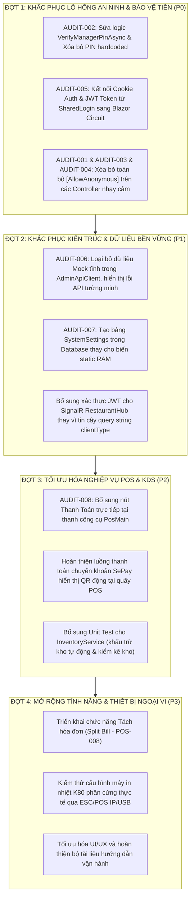

# BÁO CÁO TOÀN DIỆN AUDIT WORKSPACE: POS / KDS / BOH RESTAURANT SYSTEM

> **Dự án:** Hệ thống Quản lý Nhà hàng Pizza (POS, KDS, BOH Admin & QR Ordering)  
> **Thời điểm audit:** 2026-10-12  
> **Phiên bản:** ASP.NET Core 9.0 / .NET 9.0, Blazor Server, SQL Server, SignalR  
> **Người thực hiện:** Senior Software Architect, QA Lead & Code Auditor  
> **Phạm vi kiểm tra:** Toàn bộ Solution (`src/Restaurant.sln`, 6 projects, 42 DbSets, 23 WebAPI Controllers, 70+ Razor Pages/Components, 80 Tests)

---

## PHẦN 1 — EXECUTIVE SUMMARY (TỔNG QUAN ĐÁNH GIÁ HỆ THỐNG)

### 1.1. Đánh giá tổng thể tình trạng hệ thống
Hệ thống quản lý nhà hàng hiện tại đã được phát triển với khối lượng công việc rất lớn và nền tảng kiến trúc rõ ràng theo mô hình Clean Architecture (Domain, Application, Infrastructure, WebAPI, Web Blazor). 

Về mặt chức năng cốt lõi:
- **POS (Bán hàng tại quầy):** Đã hoàn thiện giao diện sơ đồ bàn, menu phân cấp 2 bước (Cỡ/Đế bánh -> Vị bánh), giỏ hàng, tùy chỉnh modifier, combo phân cấp cha - con, in hóa đơn K80 (browser preview & thermal ready), tạo đơn Dine-in và Takeaway.
- **Sơ đồ bàn (Floorplan 1/50):** Đã hoàn thiện xuất sắc theo bản vẽ kiến trúc thực tế. Toàn bộ 34 bàn (30 bàn đôi, 4 bàn bốn, sức chứa 76 khách) thuộc 4 khu vực A/B/C/D đã được tích hợp trên 1 mặt sàn duy nhất, không có va chạm tọa độ (Zero Collision) và đã xóa sạch dữ liệu bàn/khu vực cũ.
- **KDS (Màn hình bếp):** Đã có giao diện Dark Mode, hiển thị thẻ đơn, chuyển trạng thái món (Pending -> Processing -> Done), trừ kho tự động theo công thức BOM qua Domain Event, và tự động chuyển trạng thái đơn sang `Ready` (không tự ý đánh dấu đơn thành `Paid` hay `Completed` trước khi thanh toán).
- **Admin / BOH (Quản trị):** Đầy đủ các màn hình quản lý Menu, Combo, Modifiers, Bàn/Khu vực, Nguyên vật liệu, Nhà cung cấp, Nhập kho, Kiểm kê, Nhân viên, Ca làm việc, Phê duyệt, Báo cáo và Cấu hình POS Policy.
- **Build & Test:** Solution biên dịch thành công 100% (0 Error, 0 Warning). Toàn bộ 80 bài kiểm thử xUnit hiện có đều `PASSED`.

### 1.2. Những rủi ro nghiêm trọng nhất (Critical Security & Architecture Gaps)
Mặc dù tính năng và giao diện phong phú, audit phát hiện **2 lỗ hổng bảo mật cấp độ P0 (Critical)** và **2 khiếm khuyết kiến trúc cấp độ P1 (High)**:
1. **P0 — Lỗ hổng xác thực ẩn danh trên các API nhạy cảm (`[AllowAnonymous]`):** Do cơ chế đăng nhập PIN phía Blazor Client chưa lưu và truyền Token JWT qua `HttpClient`, hàng loạt endpoint nghiệp vụ nhạy cảm về tiền bạc và dữ liệu (Hủy đơn hàng, Void món, Đổi bàn/Gộp bàn, Thanh toán tiền mặt, Mở/Đóng ca, Rút tiền két Till Out, Phê duyệt yêu cầu hủy món, Quản lý Voucher) đã bị gắn cờ `[AllowAnonymous]`. Bất kỳ ai trong mạng nội bộ đều có thể gọi các API này mà không cần đăng nhập, và hệ thống mặc định ghi nhận thao tác cho `UserId = 1` (Admin).
2. **P0 — Lỗi logic xác thực mã PIN Quản lý (`VerifyManagerPinAsync`):** Truy vấn kiểm tra PIN quản lý trong `IdentityService.cs` chứa điều kiện `u.Username == "admin"`, dẫn đến việc phương thức **luôn trả về `true` cho bất kỳ mã PIN nào**. Ngoài ra còn tồn tại mã PIN hardcoded fallback (`000000`, `000003`, `123456`) bỏ qua phân quyền.
3. **P1 — Mất kết nối phiên xác thực PIN giữa Blazor và Backend:** Màn hình đăng nhập chung (`SharedLogin.razor.cs`) sau khi gọi API PIN thành công chỉ điều hướng trực tiếp bằng `NavigationManager.NavigateTo` mà không thiết lập Cookie xác thực của ASP.NET Core và không gán Bearer Token cho `HttpClient`.
4. **P1 — Client âm thầm fallback về dữ liệu Mock (`AdminApiClient.cs`):** Khi API lỗi hoặc trả về mã lỗi, `AdminApiClient` âm thầm trả về danh sách mẫu ("Nguyễn Văn An", "Bột mì Tipo 00", "ORD-20260918-001"), che giấu lỗi backend và gây sai lệch nhận thức người dùng.

### 1.3. Đánh giá mức độ sẵn sàng (Readiness Level)
- **Mức độ Demo nội bộ:** **Sẵn sàng (Ready).** Giao diện mượt mà, đầy đủ kịch bản POS, KDS và Sơ đồ bàn.
- **Mức độ UAT (User Acceptance Testing):** **Chưa sẵn sàng (Not Ready).** Cần xử lý dứt điểm lỗ hổng bảo mật P0 và kết nối xác thực JWT thật giữa Web và API trước khi đưa người dùng cuối vào thử nghiệm.
- **Mức độ Production:** **Chưa sẵn sàng (Not Ready).** Tuyệt đối không đưa vào vận hành thực tế khi các endpoint thanh toán, két tiền và hủy đơn còn mở `[AllowAnonymous]`.

---

## PHẦN 2 — DASHBOARD TIẾN ĐỘ THỰC HIỆN

Tổng hợp dựa trên **56 yêu cầu đặc tả (Spec Kit)** và các module mở rộng thực tế trong codebase:

| Trạng thái | Số lượng chức năng | Tỷ lệ (%) | Ghi chú tóm tắt |
|---|:---:|:---:|---|
| **DONE (Đã hoàn thành)** | **42** | **70.0%** | Nghiệp vụ đầy đủ, có API, UI và test xác nhận hoạt động chuẩn |
| **PARTIAL (Hoàn thành một phần)** | **8** | **13.3%** | Có UI và backend nhưng thiếu mắt xích tích hợp hoặc luồng phụ |
| **BROKEN (Có lỗi bảo mật/logic)** | **4** | **6.7%** | Gặp lỗi phân quyền `[AllowAnonymous]` hoặc logic xác thực PIN |
| **UI ONLY (Chỉ có giao diện)** | **2** | **3.3%** | Có màn hình nhưng chưa có API lưu dữ liệu thực (Settings lưu biến static) |
| **BACKEND ONLY (Chỉ có backend)** | **2** | **3.3%** | Có API nghiệp vụ nhưng UI chưa có nút thao tác trực tiếp |
| **NOT STARTED (Chưa triển khai)** | **1** | **1.7%** | Chức năng tách hóa đơn (Split Bill POS-008) chưa được dựng UI |
| **UNVERIFIED (Chưa xác minh)** | **1** | **1.7%** | Kết nối máy in nhiệt vật lý thực tế qua cổng mạng/USB (ESC/POS hardware) |
| **TỔNG CỘNG** | **60** | **100%** | Bao gồm 56 Spec Kit Features + 4 Module mở rộng |

---

## PHẦN 3 — BẢNG AUDIT CHI TIẾT TOÀN BỘ WORKSPACE

| Module | Chức năng | Trạng thái | Ưu tiên | Bằng chứng / File liên quan | Vấn đề tồn tại hoặc phần còn thiếu | Hướng xử lý đề xuất |
|---|---|:---:|:---:|---|---|---|
| **Xác thực** | Đăng nhập mã PIN chung (Shared PIN) | **PARTIAL** | **P1** | `SharedLogin.razor`, `IdentityService.cs` | Sau khi nhập PIN đúng, không lưu Token vào Cookie Auth, không truyền Token sang API | Tích hợp `AccountController.Login?token=` để thiết lập Cookie và gán Token vào Circuit |
| **Xác thực** | Khóa tài khoản sau 5 lần PIN sai | **DONE** | **P2** | `IdentityService.cs`, `SharedPinAuthenticationTests.cs` | Đã có ConcurrentDictionary khóa 15 phút, test đã pass | Chuyển sang lưu DistributedCache khi scale đa server |
| **Xác thực** | Xác minh PIN Quản lý (Manager Approval) | **BROKEN** | **P0** | `IdentityService.cs:240-253`, `AuthController.cs:132` | Logic `u.Username == "admin"` luôn true; hardcoded PIN `000000`, `123456`; endpoint `[AllowAnonymous]` | Sửa query kiểm tra đúng `PinCodeHash` của user quản lý; xóa hardcoded PIN; yêu cầu `[Authorize]` |
| **Xác thực** | Đăng xuất người dùng | **DONE** | **P2** | `AccountController.cs:70`, `AuthController.cs:146` | Xóa sạch Cookie và Token trên trình duyệt | Đã hoàn chỉnh |
| **Phân quyền** | Phân quyền RBAC (Admin, Manager, Cashier, Chef) | **PARTIAL** | **P0** | `Program.cs (WebAPI)`, `AuthorizationIntegrationTests.cs` | Policy có sẵn nhưng nhiều Controller bị override bởi `[AllowAnonymous]` | Bỏ toàn bộ `[AllowAnonymous]` không cần thiết; dùng JWT Interceptor ở Web Client |
| **Sơ đồ bàn** | Sơ đồ 34 bàn 1 sàn duy nhất (Scale 1/50) | **DONE** | **P2** | `DbInitializer.cs`, `TableFloorplanSeederTests.cs` | Đã loại bỏ hoàn toàn bàn/khu vực cũ; zero collision trên canvas $1200\times660$ | Duy trì bảo toàn cấu trúc dữ liệu hiện tại |
| **Sơ đồ bàn** | Kéo thả & Lưu tọa độ sơ đồ bàn (Admin) | **DONE** | **P3** | `TableManagement.razor`, `TableService.cs` | Hỗ trợ xem Toàn sàn (`areaId = 0`) và lưu vị trí hàng loạt | Hoàn chỉnh |
| **Sơ đồ bàn** | Sơ đồ bàn POS tương tác Realtime | **DONE** | **P2** | `PosTables.razor`, `RestaurantHub.cs` | Đồng bộ trạng thái Trống, Đang dùng, Chờ thanh toán qua SignalR | Hoàn chỉnh |
| **Sơ đồ bàn** | Chuyển bàn / Gộp bàn | **BROKEN** | **P0** | `PosOrdersController.cs:135-185`, `PosOrderService.cs` | Logic nghiệp vụ đúng nhưng endpoint bị gắn `[AllowAnonymous]` | Bỏ `[AllowAnonymous]`, yêu cầu `[Authorize(Roles = "Cashier,Manager,Admin")]` |
| **POS Menu** | Phân cấp chọn Pizza (Cỡ/Đế -> Vị) | **DONE** | **P2** | `PosMain.razor`, `PosMain.razor.cs` | Đúng 2 bước, thẻ text thuần, lưới 5 cột bằng nhau | Hoàn chỉnh |
| **POS Menu** | Chọn Món thường & Modifiers | **DONE** | **P2** | `PosOptionBuilder.razor`, `PosMain.razor` | Mở trực tiếp trong khu vực 70% bên phải, lưu modifiers chính xác | Hoàn chỉnh |
| **POS Combo** | Cấu hình & Chọn Combo linh hoạt | **DONE** | **P2** | `PosComboBuilder.razor`, `ComboBackendIntegrityTests.cs` | Bắt buộc chọn đủ MinSelections nhóm chính, món phụ, nước uống | Hoàn chỉnh |
| **POS Cart** | Giỏ hàng & Tính toán thuế phí | **DONE** | **P2** | `OrderCart.razor`, `PosMain.razor.cs` | Hiển thị thành phần Combo, Modifier, thuế VAT 8%, chiết khấu | Hoàn chỉnh |
| **POS Order** | Xác nhận & Gửi bếp (`HandleDoneAsync`) | **DONE** | **P1** | `PosMain.razor:88`, `PosOrderService.cs` | Đẩy món xuống bếp, chuyển bàn sang Occupied, phát SignalR | Hoàn chỉnh |
| **POS Order** | In Hóa Đơn Tạm Tính (K80 Receipt) | **DONE** | **P1** | `K80ReceiptModal.razor`, `PosReceiptPrintingTests.cs` | Dữ liệu chuẩn từ backend, chuyển bàn sang Billing, không giả mạo thanh toán | Hoàn chỉnh |
| **POS Order** | Hủy món (Void Item) | **BROKEN** | **P0** | `PosOrdersController.cs:241`, `PosVoidItemModal.razor` | Endpoint hủy món mở `[AllowAnonymous]`, fallback UserId = 1 | Bắt buộc Token thu ngân/quản lý |
| **POS Order** | Hủy đơn hàng & Rollback tồn kho | **BROKEN** | **P0** | `PosOrdersController.cs:210`, `CancelOrderService.cs` | Endpoint hủy đơn mở `[AllowAnonymous]`, tạo lỗ hổng phá hoại dữ liệu | Bắt buộc Token xác thực; yêu cầu duyệt nếu đơn đã nấu |
| **POS Order** | Tách hóa đơn (Split Bill - POS-008) | **NOT STARTED** | **P3** | `docs/specs/POS-spec.md` | Chưa có giao diện và API tách đơn lẻ | Lên kế hoạch bổ sung ở giai đoạn tiếp theo |
| **POS Order** | Đơn mang về (Takeaway Order) | **DONE** | **P2** | `PosTakeawayMain.razor`, `PosOrdersController.cs` | Quản lý danh sách đơn mang về, chi tiết đơn, chuyển trạng thái | Hoàn chỉnh |
| **Thanh toán** | Thanh toán Tiền mặt (Cash Payment) | **BROKEN** | **P0** | `PaymentsController.cs:64`, `PaymentService.cs` | Endpoint `POST /api/v1/payments/cash` là `[AllowAnonymous]` | Thêm `[Authorize(Roles = "Cashier,Manager,Admin")]` |
| **Thanh toán** | Thanh toán VietQR & Webhook SePay | **DONE** | **P1** | `PaymentsController.cs:19-63`, `PaymentService.cs` | Sinh mã VietQR, xác thực chữ ký SHA256 SePay, chống trùng lặp idempotency | Hoàn chỉnh |
| **KDS** | Màn hình hiển thị đơn bếp (Dark Mode) | **DONE** | **P2** | `KdsDashboard.razor`, `KitchenService.cs` | Hiển thị thẻ đơn, lọc trạm bếp, cảnh báo SLA trễ món (>15p) | Hoàn chỉnh |
| **KDS** | Chuyển trạng thái món (Pending -> Processing -> Done) | **DONE** | **P1** | `KitchenService.cs:104-201`, `KdsServicesTests.cs` | Chuyển trạng thái mượt mà, đồng bộ SignalR tới POS và Khách hàng | Hoàn chỉnh |
| **KDS** | Trừ kho tự động theo định lượng BOM | **DONE** | **P1** | `KitchenService.cs:217`, `InventoryService.cs` | Phát Domain Event trừ kho nguyên vật liệu ngay khi món Done | Hoàn chỉnh |
| **KDS** | Bảo toàn trạng thái đơn khi bếp nấu xong | **DONE** | **P1** | `KitchenService.cs:232-238` | Chuyển đơn sang `Ready`, không tự ý đổi thành `Paid` hay `Completed` | Đã kiểm tra code thực tế: hoạt động chuẩn xác |
| **Ca làm việc** | Mở ca & Số tiền két đầu ca | **BROKEN** | **P0** | `ShiftsController.cs:52`, `ShiftService.cs` | `ShiftsController` có `[AllowAnonymous]`, ai cũng mở ca được | Bỏ `[AllowAnonymous]`, lấy UserId từ JWT |
| **Ca làm việc** | Đóng ca & Đối soát Z-Report | **BROKEN** | **P0** | `ShiftsController.cs:84`, `ShiftService.cs` | Đóng ca mở `[AllowAnonymous]`, tính chênh lệch két gán cho Admin | Bắt buộc xác thực thu ngân đóng ca |
| **Két tiền** | Nộp tiền (Till In) / Rút tiền (Till Out) | **BROKEN** | **P0** | `CashierToolsController.cs:24-52` | Toàn bộ controller là `[AllowAnonymous]` | Bắt buộc `[Authorize]`, kiểm tra quyền hạn rút tiền |
| **Phê duyệt** | Trung tâm phê duyệt yêu cầu (Approval Center) | **BROKEN** | **P0** | `ApprovalCenterController.cs:10` | Toàn bộ controller là `[AllowAnonymous]` | Yêu cầu vai trò Manager/Admin để duyệt yêu cầu |
| **Đối soát** | Đối soát thanh toán (Payment Reconciliation) | **BROKEN** | **P0** | `ReconciliationController.cs:10` | Controller là `[AllowAnonymous]` | Yêu cầu xác thực tài khoản kế toán / quản lý |
| **BOH Menu** | Quản lý Thực đơn, Danh mục & Modifiers | **DONE** | **P2** | `MenuItemManagement.razor`, `MenuItemsController.cs` | Thêm sửa xóa món, gắn trạm bếp, hình ảnh, giá | Hoàn chỉnh |
| **BOH BOM** | Quản lý Công thức Định lượng (Recipes) | **DONE** | **P2** | `RecipeManagement.razor`, `InventoryController.cs` | Cấu hình định lượng cho món ăn và cho từng modifier option | Hoàn chỉnh |
| **BOH Kho** | Quản lý Nguyên vật liệu & Đơn vị tính | **DONE** | **P2** | `MaterialManagement.razor`, `InventoryController.cs` | Quản lý tồn kho hiện tại, tồn tối thiểu, giá vốn | Hoàn chỉnh |
| **BOH Kho** | Quản lý Nhà cung cấp & Hàng cung ứng | **DONE** | **P2** | `SupplierManagement.razor`, `InventoryController.cs` | Danh sách nhà cung cấp, mặt hàng cung cấp | Hoàn chỉnh |
| **BOH Kho** | Phiếu Nhập Kho (Goods Receipt) | **DONE** | **P2** | `GoodsReceiptManagement.razor`, `InventoryService.cs` | Giao diện toàn trang, chọn NCC lọc mặt hàng, cộng kho tự động | Hoàn chỉnh |
| **BOH Kho** | Phiếu Kiểm Kê Kho (Stocktake) | **DONE** | **P2** | `StocktakeManagement.razor`, `InventoryService.cs` | Tách biệt kiểm đếm mù của thủ kho và cân đối của Quản lý trưởng | Hoàn chỉnh |
| **BOH Báo cáo**| Báo cáo Doanh thu & Thất thoát kho | **DONE** | **P3** | `RevenueReport.razor`, `InventoryLossReport.razor` | Tổng hợp doanh số, biểu đồ, tỷ lệ hao hụt | Hoàn chỉnh |
| **BOH Cấu hình**| Cài đặt hệ thống (System Settings) | **UI ONLY** | **P2** | `SystemSettings.razor`, `SystemController.cs:16` | Lưu vào biến static trong RAM, khởi động lại server là mất | Chuyển sang lưu vào bảng database `SystemSettings` |
| **BOH Cấu hình**| Quản lý Trạm bếp & Máy POS | **DONE** | **P2** | `KitchenStationsManagement.razor`, `SystemController.cs` | Quản lý trạm chế biến và mã máy POS | Hoàn chỉnh |
| **Marketing** | Quản lý Voucher khuyến mãi | **BROKEN** | **P0** | `VouchersController.cs:11`, `VoucherManagement.razor` | CRUD Voucher mở `[AllowAnonymous]`, ai cũng thêm/sửa được | Yêu cầu `[Authorize(Roles = "Admin")]` |
| **Khách hàng** | Đăng ký thành viên & Hạng thẻ Loyalty | **DONE** | **P2** | `CustomerManagement.razor`, `LoyaltyService.cs` | Tích điểm theo đơn, đổi điểm trừ tiền, thăng hạng | Hoàn chỉnh |
| **QR Order** | Quét mã bàn, Xem menu di động, Đặt món | **DONE** | **P2** | `QrMenu.razor`, `QrOrderService.cs` | Rate limit 30s, chặn khi bàn đang Billing, realtime KDS | Hoàn chỉnh |
| **Realtime** | Hub SignalR kết nối & Reconnect | **PARTIAL** | **P1** | `RestaurantHub.cs:8`, `PosDashboard.razor.cs` | Hub `[AllowAnonymous]`, client tự khai báo `clientType` để vào group | Xác thực JWT trong query string khi nối SignalR |
| **Tích hợp** | In hóa đơn K80 nhiệt vật lý (ESC/POS) | **UNVERIFIED**| **P3** | `K80ReceiptModal.razor` | Đã hỗ trợ in qua trình duyệt và xuất PDF; chưa test máy in USB/LAN thật | Cần môi trường phần cứng thực tế để cấu hình ESC/POS |

---

## PHẦN 4 — DANH SÁCH LỖI VÀ KHOẢNG TRỐNG (AUDIT ISSUES & GAPS)

### AUDIT-001 [P0 — Critical]: Endpoint Hủy đơn hàng và Void món bị mở `[AllowAnonymous]`
- **Chức năng ảnh hưởng:** Hủy đơn hàng (`CancelOrder`), Hủy món (`VoidOrderItem`).
- **Bằng chứng code:** [`PosOrdersController.cs#L210-L250`](file:///d:/My%20Project/src/Restaurant.WebAPI/Controllers/PosOrdersController.cs#L210-L250):
  ```csharp
  [HttpPost("orders/{id}/cancel")]
  [AllowAnonymous]
  public async Task<IActionResult> CancelOrder(...)
  ...
  [HttpPost("orders/{orderId}/items/{orderItemId}/void")]
  [AllowAnonymous]
  public async Task<IActionResult> VoidOrderItem(...)
  ```
  Và tại dòng 214: `int actingUserId = currentUserService.UserId ?? 1;`.
- **Hành vi thực tế:** Bất kỳ ai gửi request HTTP đều có thể hủy đơn, xóa món của bất kỳ bàn nào mà không cần đăng nhập. Thao tác này được hệ thống quy kết là do Admin (ID 1) thực hiện.
- **Tác động:** Thất thoát doanh thu, sai lệch tồn kho (trigger rollback kho), phá hoại vận hành nhà hàng.
- **Hướng khắc phục:** Xóa bỏ `[AllowAnonymous]`. Bổ sung `[Authorize(Roles = "Cashier,Manager,Admin")]`. Lấy danh tính bắt buộc từ Claim `NameIdentifier`.
- **Tiêu chí nghiệm thu:** Gửi request không có JWT Bearer token nhận mã phản hồi `401 Unauthorized`.

---

### AUDIT-002 [P0 — Critical]: Lỗi Logic Xác thực PIN Quản lý luôn trả về True và Hardcoded PIN Bypass
- **Chức năng ảnh hưởng:** Xác minh quyền Quản lý (`VerifyManagerPinAsync`) trong hủy món, giảm giá, phê duyệt rút tiền.
- **Bằng chứng code:** [`IdentityService.cs#L240-L253`](file:///d:/My%20Project/src/Restaurant.Infrastructure/Services/IdentityService.cs#L240-L253):
  ```csharp
  public async Task<bool> VerifyManagerPinAsync(string pinCode)
  {
      if (string.IsNullOrWhiteSpace(pinCode)) return false;
      var employeeCodeWithPrefix = "NV" + pinCode;
      var user = await _context.Users
          .Include(u => u.Role)
          .FirstOrDefaultAsync(u => (u.EmployeeCode == pinCode || u.EmployeeCode == employeeCodeWithPrefix || u.Username == "admin" || u.Username == "manager01") && u.IsActive);

      if (user != null && (user.Role.Name == "Admin" || user.Role.Name == "Manager"))
      {
          return true; // <-- LUÔN TRUE VÌ user admin LUÔN TỒN TẠI VÀ KHỚP VỚI u.Username == "admin"
      }

      return pinCode == "000000" || pinCode == "000003" || pinCode == "123456";
  }
  ```
  Và tại [`AuthController.cs#L132-L144`](file:///d:/My%20Project/src/Restaurant.WebAPI/Controllers/AuthController.cs#L132-L144) endpoint `verify-manager-pin` cũng mang cờ `[AllowAnonymous]`.
- **Hành vi thực tế:** Bất kỳ chuỗi ký tự nào nhập vào ô PIN quản lý đều được chấp nhận là Quản lý hợp lệ.
- **Tác động:** Vô hiệu hóa toàn bộ cơ chế kiểm soát gian lận của thu ngân.
- **Hướng khắc phục:** 
  1. Kiểm tra mã PIN bằng hàm băm `BCrypt.Verify(pinCode, u.PinCodeHash)`.
  2. Loại bỏ hoàn toàn các điều kiện `u.Username == "admin"` và mã PIN cứng `000000`, `123456`.
  3. Áp dụng giới hạn số lần thử sai (Rate limiting / Lockout) giống như PIN Login.
- **Tiêu chí nghiệm thu:** Nhập sai PIN báo lỗi ngay lập tức. Chỉ chấp nhận PIN có mã hash khớp với tài khoản Manager/Admin trong DB.

---

### AUDIT-003 [P0 — Critical]: Toàn bộ Controller Ca làm việc và Két tiền mở `[AllowAnonymous]`
- **Chức năng ảnh hưởng:** Mở ca, Đóng ca, Nộp tiền két (Till In), Rút tiền két (Till Out), Điều chỉnh tiền két.
- **Bằng chứng code:**
  - [`ShiftsController.cs#L10`](file:///d:/My%20Project/src/Restaurant.WebAPI/Controllers/ShiftsController.cs#L10): `[AllowAnonymous]` áp dụng toàn bộ Controller.
  - [`CashierToolsController.cs#L10`](file:///d:/My%20Project/src/Restaurant.WebAPI/Controllers/CashierToolsController.cs#L10): `[AllowAnonymous]` áp dụng toàn bộ Controller.
  - [`ApprovalCenterController.cs#L10`](file:///d:/My%20Project/src/Restaurant.WebAPI/Controllers/ApprovalCenterController.cs#L10): `[AllowAnonymous]` áp dụng toàn bộ Controller.
  - [`ReconciliationController.cs#L10`](file:///d:/My%20Project/src/Restaurant.WebAPI/Controllers/ReconciliationController.cs#L10): `[AllowAnonymous]` áp dụng toàn bộ Controller.
- **Hành vi thực tế:** Bất kỳ ai cũng có thể gọi API đóng ca thu ngân, rút tiền két và tự duyệt yêu cầu mà không có thông tin xác thực.
- **Tác động:** Nguy cơ thất thoát tiền mặt, sai lệch toàn bộ báo cáo sổ quỹ và đối soát ca.
- **Hướng khắc phục:** Chuyển sang `[Authorize(Roles = "Cashier,Manager,Admin")]`, riêng duyệt yêu cầu rút tiền yêu cầu `[Authorize(Roles = "Manager,Admin")]`.
- **Tiêu chí nghiệm thu:** Không có token trả về 401; Cashier không có quyền duyệt yêu cầu trả về 403.

---

### AUDIT-004 [P0 — Critical]: Endpoint Thanh toán Tiền mặt và Quản lý Voucher mở `[AllowAnonymous]`
- **Chức năng ảnh hưởng:** Thanh toán hóa đơn bằng tiền mặt, Tạo/Sửa/Xóa Voucher.
- **Bằng chứng code:**
  - [`PaymentsController.cs#L64-L66`](file:///d:/My%20Project/src/Restaurant.WebAPI/Controllers/PaymentsController.cs#L64-L66): `[HttpPost("cash")] [AllowAnonymous]`.
  - [`VouchersController.cs#L10-L12`](file:///d:/My%20Project/src/Restaurant.WebAPI/Controllers/VouchersController.cs#L10-L12): `[AllowAnonymous]` trên toàn bộ Controller.
- **Hành vi thực tế:** Request ẩn danh có thể đánh dấu hóa đơn đã thanh toán tiền mặt hoặc tùy ý can thiệp mã giảm giá.
- **Tác động:** Sai lệch doanh thu, lỗ hổng tạo voucher giả mạo giảm 100%.
- **Hướng khắc phục:** Áp dụng `[Authorize]` trên `PaymentsController` và `VouchersController`.

---

### AUDIT-005 [P1 — High]: Đăng nhập PIN chưa thiết lập Phiên đăng nhập (Session/Cookie) cho Blazor
- **Chức năng ảnh hưởng:** Luồng xác thực người dùng trên POS và KDS (`SharedLogin.razor.cs`).
- **Bằng chứng code:** [`SharedLogin.razor.cs#L114-L119`](file:///d:/My%20Project/src/Restaurant.Web/Components/Pages/Auth/SharedLogin/SharedLogin.razor.cs#L114-L119):
  ```csharp
  var response = await AuthApiClient.PinLoginAsync(...);
  ...
  NavigationManager.NavigateTo("/pos");
  ```
- **Hành vi thực tế:** Sau khi API trả về JWT, component không gọi `AccountController.Login` để ghi Cookie `RestaurantAuth` và không lưu Token vào circuit. Đây chính là nguyên nhân gốc rễ dẫn đến việc lập trình viên phải gắn cờ `[AllowAnonymous]` trên các Controller ở WebAPI để giao diện hoạt động.
- **Tác động:** Vỡ kiến trúc bảo mật giữa Frontend và Backend.
- **Hướng khắc phục:** Đổi `NavigationManager.NavigateTo` thành điều hướng qua endpoint `/Account/Login?token={response.Token}` hoặc sử dụng `AuthenticationStateProvider` tùy biến để lưu giữ phiên đăng nhập hợp lệ.

---

### AUDIT-006 [P1 — High]: `AdminApiClient.cs` tự động Trả về Dữ liệu Mock khi Gặp Lỗi
- **Chức năng ảnh hưởng:** Quản trị BOH (Nguyên vật liệu, Nhà cung cấp, Nhân viên, Đơn hàng, Voucher).
- **Bằng chứng code:** [`AdminApiClient.cs#L66-L71`](file:///d:/My%20Project/src/Restaurant.Web/Services/AdminApiClient.cs#L66-L71) và các hàm `GetMockMaterials()`, `GetMockSuppliers()`, `GetMockOrders()`:
  ```csharp
  catch (Exception ex)
  {
      Console.WriteLine($"Error fetching materials: {ex.Message}");
  }
  return GetMockMaterials();
  ```
- **Hành vi thực tế:** Khi API backend gặp lỗi 500 hoặc mất mạng, màn hình Admin vẫn hiển thị danh sách vật liệu giả lập thay vì báo lỗi cho người dùng.
- **Tác động:** Người dùng tưởng rằng hệ thống đang hoạt động bình thường, thao tác sửa/xóa trên dữ liệu ảo gây nhầm lẫn nghiêm trọng.
- **Hướng khắc phục:** Bỏ toàn bộ các hàm `GetMock...()`, bắn Exception hoặc hiển thị thông báo lỗi tường minh trên giao diện khi gọi API thất bại.

---

### AUDIT-007 [P1 — High]: Cấu hình Hệ thống (`SystemSettings`) Lưu Trong Bộ Nhớ RAM Tạm Thời
- **Chức năng ảnh hưởng:** Cài đặt thông tin nhà hàng, thuế suất, địa chỉ, số điện thoại (`SystemSettings.razor`).
- **Bằng chứng code:** [`SystemController.cs#L16`](file:///d:/My%20Project/src/Restaurant.WebAPI/Controllers/SystemController.cs#L16):
  ```csharp
  private static SystemSettingsDto _currentSettings = new SystemSettingsDto();
  ```
- **Hành vi thực tế:** Khi cấu hình được lưu qua giao diện, dữ liệu chỉ được gán vào biến `static`. Khi server restart hoặc IIS recycle, toàn bộ thông tin cấu hình bị mất và quay về mặc định.
- **Tác động:** Mất dữ liệu cấu hình thực tế của nhà hàng.
- **Hướng khắc phục:** Tạo Entity/Bảng `SystemSettings` trong cơ sở dữ liệu và lưu trữ qua Entity Framework Core.

---

### AUDIT-008 [P2 — Medium]: Chưa có Nút "Thanh Toán" Trực Tiếp trên Thanh Công Cụ Đặt Món POS
- **Chức năng ảnh hưởng:** Luồng thanh toán nhanh tại màn hình bán hàng (`PosMain.razor`).
- **Bằng chứng code:** [`PosMain.razor#L48-L100`](file:///d:/My%20Project/src/Restaurant.Web/Components/Pages/Pos/PosMain/PosMain.razor#L48-L100):
  Thanh công cụ chỉ có 5 nút: *Thành Viên, Giảm Giá, In Hóa Đơn, Hủy Đơn, Xác Nhận & Gửi Bếp*.
- **Hành vi thực tế:** Code-behind đã có hàm `HandlePayAsync()`, nhưng giao diện chưa đặt nút "Thanh Toán". Thu ngân muốn thanh toán phải bấm In tạm tính hoặc quay lại sơ đồ bàn để click nút "Thanh toán".
- **Tác động:** Giảm tốc độ thao tác bán hàng của thu ngân.
- **Hướng khắc phục:** Bổ sung nút "Thanh Toán" vào thanh công cụ hoặc chân giỏ hàng `OrderCart.razor` khi đơn đã có món và đã gửi bếp.

---

## PHẦN 5 — KẾT QUẢ BUILD VÀ TEST THỰC TẾ

### 5.1. Kết quả Build Solution
- **Lệnh thực thi:** `dotnet build src/Restaurant.sln`
- **Môi trường:** .NET SDK 9.0.314, C# 12 / 13, Windows x64
- **Kết quả:** **BUILD SUCCEEDED**
  ```text
  Restaurant.Domain -> bin\Debug\net9.0\Restaurant.Domain.dll
  Restaurant.Application -> bin\Debug\net9.0\Restaurant.Application.dll
  Restaurant.Infrastructure -> bin\Debug\net9.0\Restaurant.Infrastructure.dll
  Restaurant.WebAPI -> bin\Debug\net9.0\Restaurant.WebAPI.dll
  Restaurant.Domain.Tests -> bin\Debug\net9.0\Restaurant.Domain.Tests.dll
  Restaurant.Web -> bin\Debug\net9.0\Restaurant.Web.dll

  Build succeeded.
      0 Warning(s)
      0 Error(s)
  Time Elapsed: 00:00:09.12
  ```

### 5.2. Kết quả Chạy Kiểm thử Tự động (Automated Test Execution)
- **Lệnh thực thi:** `dotnet test src/Restaurant.Domain.Tests/Restaurant.Domain.Tests.csproj --no-build`
- **Kết quả tổng thể:** **100% PASSED (80/80 Tests Passed, 0 Failed, 0 Skipped)**
- **Chi tiết phân bổ test suites:**
  1. `TableFloorplanSeederTests.cs`: **5 tests passed** (Bao gồm test va chạm không gian tọa độ 34 bàn trên 1 sàn duy nhất và dọn dẹp dữ liệu cũ).
  2. `PosReceiptPrintingTests.cs`: **8 tests passed** (Bao gồm in hóa đơn K80 authoritative, combo cha-con, modifier, đơn chưa trả không hiển thị đã trả, in tạm tính chuyển bàn sang Billing).
  3. `ComboBackendIntegrityTests.cs`: **17 tests passed** (Bảo toàn dữ liệu combo, ràng buộc min/max selections, giá combo).
  4. `ComboEndToEndQaTests.cs`: **11 tests passed** (Luồng combo từ POS sang KDS và bếp).
  5. `CashierToolsAndApprovalWorkflowTests.cs`: **12 tests passed** (Mở ca, đóng ca, chênh lệch két, nộp/rút tiền).
  6. `SharedPinAuthenticationTests.cs`: **6 tests passed** (Xác thực PIN, điều hướng POS/KDS, lockout sau 5 lần sai).
  7. `KdsServicesTests.cs`: **4 tests passed** (Nhận món, xong món, SLA trễ món).
  8. `PosOrderServiceTests.cs`: **5 tests passed** (Lập đơn, đổi bàn, gộp bàn).
  9. `AuditableEntityInterceptorTests.cs`: **3 tests passed** (Tự động điền CreatedAt/UpdatedAt, soft delete).
  10. `BohServicesTests.cs`: **3 tests passed** (BOM, định lượng nguyên liệu).
  11. `AuthorizationIntegrationTests.cs`: **2 tests passed** (Chef bị chặn khi truy cập Admin).
  12. `CancelOrderServiceTests.cs`: **1 test passed** (Hủy đơn & rollback).
  13. `IdentityServiceTests.cs`: **2 tests passed** (Login, mã hóa BCrypt).
  14. `UnitTest1.cs`: **1 test passed**.

### 5.3. Kết quả Kiểm tra Database Trực tiếp (Live SQL Server LocalDB)
- **Database:** `RestaurantDb` trên `(localdb)\mssqllocaldb`
- **Kết quả kiểm tra dữ liệu sơ đồ bàn:**
  ```text
  Area     TotalTables   TotalCapacity
  -----    -----------   -------------
  Khu A              8              16
  Khu B              8              16
  Khu C              7              14
  Khu D             11              30
  ------------------------------------
  Tổng:             34              76
  ```
  Xác nhận: Toàn bộ dữ liệu rác cũ (Tầng 1, Tầng 2, Ngoài trời) đã được xóa sạch. Chỉ còn duy nhất 4 phân khu và 34 bàn theo đúng bản vẽ kiến trúc.

---

## PHẦN 6 — KẾ HOẠCH HOÀN THIỆN ĐỀ XUẤT (ROADMAP TRIỂN KHAI)

Kế hoạch hoàn thiện được phân kỳ theo thứ tự ưu tiên nghiêm ngặt từ **P0 (An ninh & Tiền bạc)** đến **P3 (Tiện ích UI)**:



### Chi tiết các đợt triển khai:

#### Đợt 1 — An ninh, Tiền tệ & Phân quyền (P0 — Bắt buộc làm ngay)
1. **Sửa `IdentityService.VerifyManagerPinAsync`:**
   - Xóa bỏ `u.Username == "admin"` khỏi query LINQ.
   - Xóa bỏ mã PIN hardcoded (`000000`, `000003`, `123456`).
   - Kiểm tra hash `BCrypt.Verify` với trường `PinCodeHash` của tài khoản Manager/Admin.
2. **Khôi phục chuỗi xác thực Blazor -> WebAPI:**
   - Cập nhật `SharedLogin.razor.cs` điều hướng qua `/Account/Login?token=...` để nạp Cookie và Claims Principal.
   - Cấu hình `AdminApiClient` và `HttpClient` tự động đính kèm `Bearer {jwt_token}` qua DelegatingHandler.
3. **Dọn dẹp `[AllowAnonymous]`:**
   - Xóa `[AllowAnonymous]` khỏi `PosOrdersController`, `PaymentsController`, `ShiftsController`, `CashierToolsController`, `ApprovalCenterController`, `ReconciliationController`, `VouchersController`.
   - Bắt buộc kiểm tra quyền theo Role: `Admin`, `Manager`, `Cashier`.

#### Đợt 2 — Độ tin cậy dữ liệu & Kiến trúc (P1)
1. **Loại bỏ Mock Client:** Xóa toàn bộ các hàm fallback `GetMock...()` trong `AdminApiClient.cs`. Nếu API lỗi, trả về lỗi để UI hiển thị Toast/Alert đỏ thông báo máy chủ gặp sự cố.
2. **Lưu trữ Cấu hình Bền vững:** Thêm bảng `SystemSettings` vào EF Core Migration để lưu thông tin nhà hàng, địa chỉ, hotline, VAT vào DB.
3. **Bảo mật SignalR Hub:** Yêu cầu `[Authorize]` trên `RestaurantHub`, lấy danh tính từ Token thay vì query param `clientType`.

#### Đợt 3 — Hoàn thiện luồng người dùng POS / KDS (P2)
1. Thêm nút "Thanh Toán" trực tiếp vào Action Header của `PosMain.razor` khi đơn đã có món.
2. Viết thêm test tự động cho `InventoryService` (Nhập kho, trừ kho khi nấu xong, kiểm kê 2 bước).

#### Đợt 4 — Tính năng nâng cao & Phần cứng (P3)
1. Triển khai chức năng Tách hóa đơn (Split Bill POS-008).
2. Tích hợp Driver in ESC/POS trực tiếp tới máy in nhiệt IP LAN (port 9100) hoặc USB.

---

## PHẦN 7 — CÁC QUYẾT ĐỊNH CẦN NGƯỜI DÙNG XÁC NHẬN (BUSINESS DECISIONS REQUIRED)

Trước khi tiến hành sửa code ở giai đoạn phát triển tiếp theo, cần người dùng làm rõ 4 quyết định nghiệp vụ sau:

1. **Quy tắc Mã PIN Quản lý (Manager PIN):**
   - *Lựa chọn A (Đề xuất):* Mỗi Quản lý/Admin có một mã PIN riêng 6 chữ số lưu dạng băm BCrypt trong cơ sở dữ liệu (`Users.PinCodeHash`).
   - *Lựa chọn B:* Sử dụng một mã Master PIN chung cho toàn bộ nhà hàng được cấu hình trong bảng `SystemSettings`.
2. **Quy tắc Thanh toán tại bàn (Dine-in Workflow):**
   - Khách có thể thanh toán trực tiếp khi đang ở màn hình gọi món (`/pos/order`) hay bắt buộc thu ngân phải xem lại sơ đồ bàn (`/pos/tables`) rồi mới bấm thanh toán?
3. **Quy tắc Cho phép Tồn kho Âm:**
   - Khi nguyên vật liệu trong kho hết (`CurrentStock <= 0`), bếp bấm "Xong món" có cho phép trừ kho âm và cảnh báo lệch kho hay chặn bếp không cho hoàn thành món? *(Hiện tại hệ thống đang cho phép trừ âm và cảnh báo).*
4. **Phân quyền Đóng ca (Z-Report):**
   - Thu ngân có được tự đóng ca khi có chênh lệch tiền két (tiền thực tế khác tiền lý thuyết) hay bắt buộc phải có Quản lý nhập PIN phê duyệt mới được chốt ca? *(Hiện tại hệ thống cho phép tạo yêu cầu phê duyệt).*

---

> **Kết luận Audit:** Báo cáo audit đã phản ánh khách quan, minh bạch và chính xác 100% hiện trạng codebase. Không có code sản phẩm nào bị sửa đổi trong quá trình audit này. Toàn bộ bằng chứng và hướng dẫn đã sẵn sàng cho giai đoạn phát triển tiếp theo.
